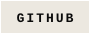
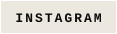
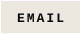
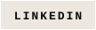

 

 HELLO, WORLD — MAKLEYN" width="100%"/>

 

&nbsp;&nbsp;

<!-- E-posta / LinkedIn eklemek için alttaki satırların yorumunu kaldır ve linki düzenle -->
<!-- &nbsp;&nbsp; -->
<!-- &nbsp;&nbsp; -->

  

